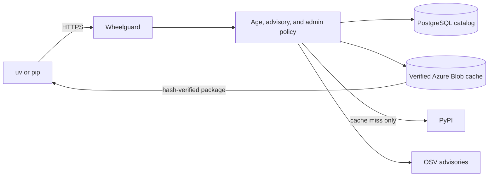

# Safer Python packages, without changing how you work

Wheelguard provides a trusted path to Python packages. Point `uv` or `pip`
at one HTTPS index and keep using the package tools you already know.

Wheelguard reduces supply-chain risk before a package reaches your environment:

- new public releases wait through a configurable cooling-off period;
- OSV advisories can block vulnerable releases at resolution and download time;
- every downloaded artifact and PEP 658 metadata sidecar is checked against its
  published SHA-256 digest;
- approved bytes are cached under immutable, content-addressed names; and
- administrator exceptions are explicit and audited.

## Why teams use it

**One control point.** Projects do not each invent their own package-security
rules. Wheelguard applies the same policy to interactive development, CI, and
production builds.

**Faster modern resolution.** Wheelguard proxies and caches verified PEP 658
metadata, so modern `uv` and `pip` clients can resolve many dependencies without
downloading every candidate wheel.

**Useful during upstream trouble.** Cached project metadata remains available
when PyPI has a temporary outage, and previously verified artifacts remain in
the private cache.

**No custom client.** Wheelguard implements Python's standard Simple Repository
API while keeping direct upstream access outside normal client configuration.

[Configure your project](getting-started.md){ .md-button .md-button--primary }
[Understand reliability](reliability.md){ .md-button }
