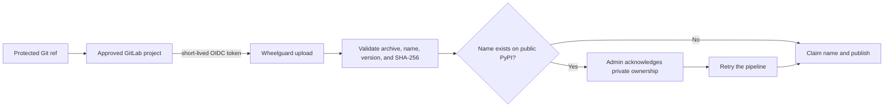

# Publish in-house packages

Wheelguard uses GitLab CI identity instead of permanent publisher passwords:

- An approved GitLab project publishes through CI using OIDC; no person handles
  a long-lived upload password.
- Wheelguard checks the package contents and claims a new internal name
  automatically.
- An admin is required only when that normalized name already exists on public
  PyPI, because approving it will intentionally hide the public package behind
  the in-house one.



## One-time project authorization

An operator adds the GitLab `project_path` to Wheelguard's publisher allowlist.
Only jobs from an allowed project and a protected Git ref are accepted. This is
a one-time trust decision for the project, not an approval for every release.

## GitLab publishing job

The job requests a short-lived ID token with Wheelguard's audience and passes it
to uv only for the upload:

```yaml
publish-package:
  image: ghcr.io/astral-sh/uv:0.9.13-python3.14-bookworm-slim
  id_tokens:
    WHEELGUARD_PUBLISH_TOKEN:
      aud: wheelguard-publisher
  script:
    - uv build
    - >-
      UV_PUBLISH_TOKEN="$WHEELGUARD_PUBLISH_TOKEN"
      uv publish
      --publish-url https://packages.example.com/upload/
      dist/*
```

Protect the branch or tag used by the publishing job. Wheelguard rejects a
validly signed token when `ref_protected` is not true or when `project_path` is
not in the allowlist.

Wheelguard validates the distribution's embedded name and version without
executing package code. Verified bytes are stored before the package is added
to the catalog. Re-uploading identical bytes under the same filename is safe;
different bytes require a new version and filename.

## Package catalog links

The Wheelguard landing page links each private package to a
small detail page with its latest version and any repository or changelog URLs
published as standard Python project metadata. Add these entries to
`pyproject.toml`:

```toml
[project.urls]
Repository = "https://gitlab.example.com/group/project"
Changelog = "https://gitlab.example.com/group/project/-/blob/main/CHANGELOG.md"
```

The next normal `uv publish` records the HTTPS links; no additional CI request
or credential is needed. A missing changelog is shown as unavailable, and the
detail page warns that opening a private GitLab link may require an account.

## Public-name collisions

The first upload checks the normalized project name against public PyPI. If the
name exists, Wheelguard returns `409 Conflict` and records the collision.

An admin reviews **Administration → Private packages** and acknowledges that the
internal package should own the name. The publishing pipeline is then retried.
Once claimed, Wheelguard exposes only the internal releases for that name; it
does not fall back to the public package. The approval and publication identity
are retained in the audit trail.

No admin action is needed for later releases of the claimed package unless an
administrator has blocked a release or the publishing project's authorization
changes.
