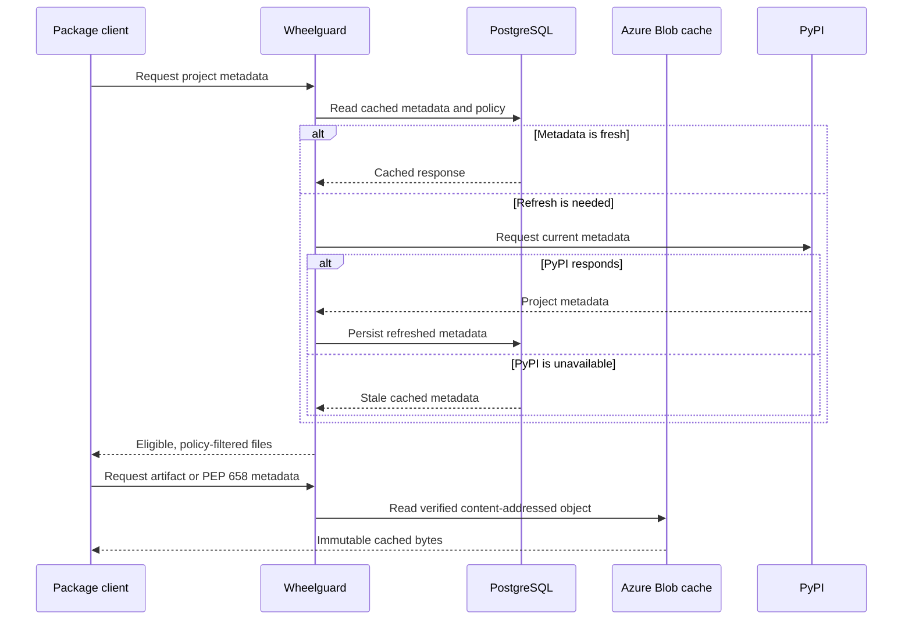

# Reliability and trust

Wheelguard is designed to keep a verified working set useful even when an
external service is degraded.

## What Wheelguard guarantees

- **TLS in transit:** clients use the HTTPS hostname configured for their deployment.
- **Digest verification:** upstream artifacts and PEP 658 sidecars are accepted
  only when their SHA-256 digest matches the upstream project metadata.
- **Immutable cache addressing:** verified objects are stored by digest, not by
  a mutable "latest" name.
- **Policy at both stages:** vulnerable or administratively blocked releases
  are filtered from listings and denied again when their artifact URL is used.
- **Stale metadata during upstream outages:** when refresh fails, Wheelguard can
  use a previously cached project response rather than immediately failing.
- **Private Azure data path:** PostgreSQL, Blob Storage, and the application are
  reached through private networking and managed identities.
- **Health-aware deployment:** the service exposes readiness checks and Azure
  Container Apps retains healthy revisions during rollout.

## Boundaries

Wheelguard cannot serve a package that has never been requested and cached when
both Wheelguard's upstream access and PyPI are unavailable. A first-time package
request still needs a working upstream.

Cached metadata does not make unsafe bytes trusted. An artifact is served only
after its own digest has been verified, and current policy is checked again on
download.

Clients should not add a second package index when Wheelguard is unavailable;
doing so bypasses its cooling-off, advisory, caching, and audit controls.
